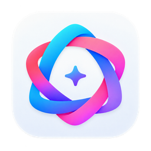

<div align="center">
  

# TaoDock Media for AstrBot

**Generate AI images and videos in any AstrBot chat with one TaoDock API key.**

[](https://github.com/taodock-api/taodock-astrbot-plugin/actions/workflows/validate.yml)
[](https://astrbot.app/)
[](https://www.python.org/)
[](LICENSE)

[Install](#installation) · [Commands](#commands) · [Configuration](#configuration) · [Privacy](#data-privacy-and-security) · [中文说明](#中文说明)

</div>

TaoDock Media adds image and video generation commands to
[AstrBot](https://github.com/AstrBotDevs/AstrBot). It connects to the official
TaoDock API, discovers the media models available to your API key, sends the
generated files back to the current chat, and lets long-running video tasks be
resumed later.

## Why this plugin

- **Image and video generation** — generate media without leaving your chat app.
- **Key-aware model discovery** — `/td_models` shows only the models your API key
  can use, so newly enabled models do not require a plugin update.
- **Resumable video tasks** — check or download an existing task by ID after the
  initial command stops waiting.
- **Cross-platform delivery** — commands run through AstrBot, so the plugin can
  be used from supported chat adapters that accept image or video messages.
- **No extra Python packages** — the API client uses Python's standard library;
  there is no third-party runtime dependency to install.
- **Defensive by default** — response-size limits, HTTPS-only image downloads,
  encoded task IDs, sanitized filenames, and no API keys in logs or replies.

## Requirements

- A working AstrBot installation with Python 3.10 or later.
- A TaoDock API key from <https://taodock.com/keys>.
- An image and/or video model enabled for that key.
- A connected chat platform capable of receiving the generated media type.

## Installation

### Install from the AstrBot dashboard

1. Open **Plugins → Installed** (or **Extensions → Plugins**, depending on your
   AstrBot version).
2. Click **Install Plugin** and choose **Install from link**.
3. Enter:

   ```text
   https://github.com/taodock-api/taodock-astrbot-plugin
   ```

4. After installation, open the plugin settings and paste your TaoDock API key.
5. Reload the plugin if AstrBot does not do so automatically.

### Install with Git

From the AstrBot project directory:

```bash
cd data/plugins
git clone https://github.com/taodock-api/taodock-astrbot-plugin.git astrbot_plugin_taodock
```

Restart AstrBot or reload the plugin from the dashboard.

## Quick start

1. List the image models your key can access:

   ```text
   /td_models image
   ```

2. Copy one model ID into the plugin's **Default image model** setting.
3. Generate an image:

   ```text
   /td_image A tiny astronaut tending a greenhouse on Mars, cinematic lighting
   ```

For video, repeat the same process with `/td_models video`, set **Default video
model**, and run `/td_video <prompt>`.

## Commands

| Command | What it does | Example |
|---|---|---|
| `/td_models image` | Lists image models available to the configured key | `/td_models image` |
| `/td_models video` | Lists video models available to the configured key | `/td_models video` |
| `/td_image <prompt>` | Generates and sends one or more images | `/td_image A watercolor harbor at dawn` |
| `/td_video <prompt>` | Creates a video task, waits for it, then sends the result | `/td_video A paper boat sailing through a city` |
| `/td_video_status <task_id>` | Returns the current status of an existing video task | `/td_video_status task_abc123` |
| `/td_video_download <task_id>` | Downloads and sends a completed video | `/td_video_download task_abc123` |

Video waiting is capped at 1,800 seconds (30 minutes). If a task is still
running when the wait ends, the command returns its task ID; use the status and
download commands later instead of starting the generation again.

## Configuration

| Setting | Required | Default | Description |
|---|---:|---:|---|
| `api_key` | Yes | — | TaoDock API key. AstrBot masks it in the dashboard. |
| `image_model` | For images | — | Default image model ID returned by `/td_models image`. |
| `image_parameters` | No | `{}` | Extra JSON object merged into image generation requests. |
| `video_model` | For videos | — | Default video model ID returned by `/td_models video`. |
| `video_parameters` | No | `{}` | Extra JSON object merged into video generation requests. |
| `video_wait_seconds` | No | `300` | Seconds to wait before returning the current task status; range 0–1,800. |

`image_parameters` and `video_parameters` must be JSON objects. The plugin
always overwrites `model` and `prompt` with the configured model and the command
text, so those two fields cannot be replaced through the JSON settings.

Example image parameters:

```json
{
  "n": 1,
  "size": "1024x1024",
  "response_format": "b64_json"
}
```

Supported parameters vary by model. Check the
[TaoDock model guide](https://docs.taodock.com/en/guide/models.html) and the
model's own documentation before adding optional fields.

## How it works

```text
Chat platform
     │  /td_image or /td_video
     ▼
AstrBot → TaoDock Media plugin
             │ Bearer API key
             ▼
       https://taodock.com/v1
             │
             ├─ /models
             ├─ /images/generations
             └─ /videos/{task}
                     │
                     ▼
        Image/video returned to chat
```

The plugin uses `asyncio.to_thread` around the standard-library HTTP client so
network and file operations do not block AstrBot's event loop.

## Troubleshooting

| Message or symptom | What to check |
|---|---|
| API key missing or invalid | Create or inspect the key at <https://taodock.com/keys>. |
| Account quota is insufficient | Check the wallet at <https://taodock.com/wallet>. |
| Model is unavailable | Run `/td_models image` or `/td_models video` with the same key. |
| Video remains queued/running | Keep the task ID and use `/td_video_status`; download after completion. |
| TaoDock cannot be reached | Check outbound HTTPS access from the AstrBot host. |
| Request failed with a request ID | Search [Common Logs](https://taodock.com/usage-logs/common), then report the request ID without the API key. |
| Media is not delivered | Verify that the current AstrBot adapter supports the corresponding image/video message component. |

## Data, privacy, and security

- The API key is sent only to `https://taodock.com/v1` in a Bearer
  authorization header. It is never included in plugin logs or chat replies.
- Prompts, model IDs, request parameters, and generated media are sent to
  TaoDock and may be retained in service logs. See the
  [TaoDock privacy policy](https://taodock.com/privacy-policy).
- Generated files are written under the operating system's temporary directory
  so AstrBot can deliver them. AstrBot and the connected platform may retain
  their own copies.
- AstrBot's `secret` configuration field masks the key in the dashboard but does
  not encrypt the plugin configuration file. Restrict access to the AstrBot data
  directory and never paste an API key into a public issue.
- Downloads enforce response-size limits: 4 MiB for JSON, 32 MiB per image, and
  512 MiB per video.

## Development

The plugin has no third-party runtime dependencies. Run the test and style
checks with:

```bash
python -m unittest discover -s tests -v
ruff check .
ruff format --check .
```

The GitHub Actions workflow runs these checks on Python 3.10 and 3.12 for every
push and pull request.

## 中文说明

这是众妙之门 TaoDock 的 AstrBot 图片/视频生成插件。安装后先在插件设置中填写
[API 密钥](https://taodock.com/keys)，再使用 `/td_models image` 或
`/td_models video` 查询当前密钥可用的模型，将模型 ID 填入默认模型设置即可。

常用命令：

```text
/td_image 一只在竹林中读书的熊猫，水墨画风格
/td_video 一艘纸船穿过雨夜城市，电影感镜头
/td_video_status <任务ID>
/td_video_download <任务ID>
```

遇到错误时可前往[通用日志](https://taodock.com/usage-logs/common)查询请求 ID。
提交 Issue 时请勿附带 API 密钥。

## Other TaoDock integrations

| Integration | Repository |
|---|---|
| WordPress AI Client | [taodock-wordpress](https://github.com/taodock-api/taodock-wordpress) |
| n8n community node | [taodock-n8n-nodes](https://github.com/taodock-api/taodock-n8n-nodes) |
| Vercel AI SDK | [taodock-ai-sdk](https://github.com/taodock-api/taodock-ai-sdk) |
| Dify tools | [taodock-dify-tools](https://github.com/taodock-api/taodock-dify-tools) |
| Model Context Protocol | [taodock-mcp](https://github.com/taodock-api/taodock-mcp) |

## License

[MIT](LICENSE)
